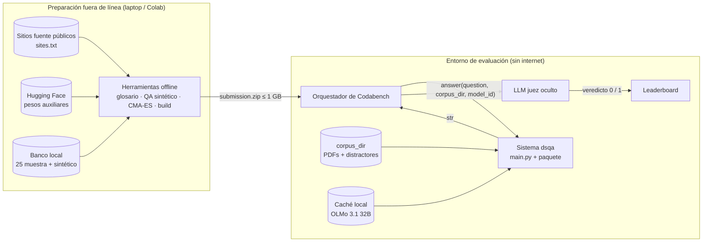
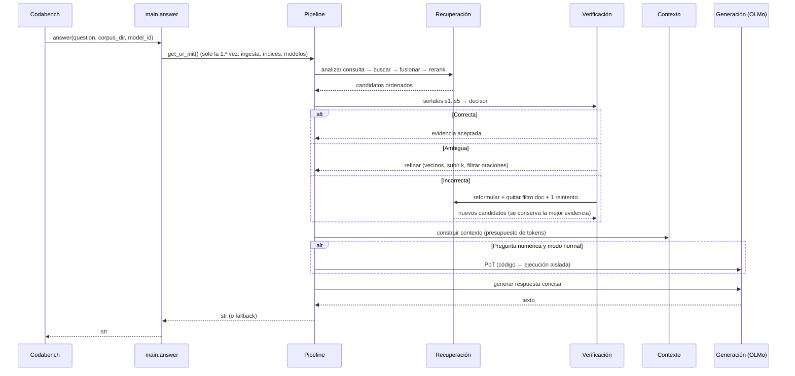
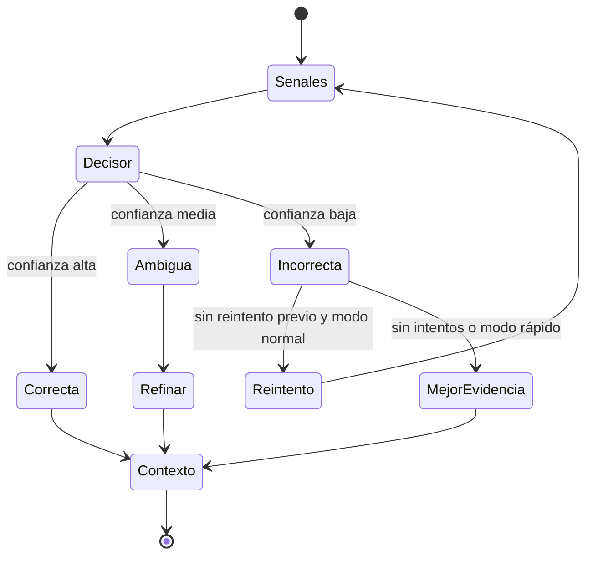

# 2. Arquitectura

[← Objetivo y alcance](01-objetivo-y-alcance.md) · [Índice](README.md) · Siguiente: [Estructura →](03-estructura-del-proyecto.md)

## 2.1 Principios de diseño

| # | Principio | Consecuencia práctica |
|---|---|---|
| P1 | **Nunca fallar** | `answer()` devuelve siempre un `str`; cada etapa tiene un fallback; un error en una pregunta no afecta a las demás |
| P2 | **El tiempo es un recurso de primera clase** | Reloj global, presupuesto por etapa, modo rápido; todo se mide |
| P3 | **Una estrategia = una configuración** | E0-E6 son YAML sobre el mismo código; cada componente se enciende o apaga por configuración |
| P4 | **Componentes intercambiables detrás de interfaces** | Buscadores, fusión, decisor y extractor implementan una interfaz común; la ablación no requiere tocar código |
| P5 | **Lo caro, una sola vez** | Modelo, índices y modelos auxiliares se cargan en la primera llamada y se cachean en memoria del proceso |
| P6 | **Separar en línea y fuera de línea** | Todo lo que puede prepararse antes (glosario, parámetros calibrados, pesos auxiliares) se prepara fuera y viaja en el zip |
| P7 | **Interpretabilidad** | Las decisiones de verificación y fusión quedan registradas con sus señales para el análisis y el paper |
| P8 | **Solo dependencias preinstaladas** | El código en línea importa únicamente librerías de `requirements-participant.txt` |

## 2.2 Vista de contexto



**Fronteras:** el sistema solo recibe la pregunta, la ruta del corpus y el identificador del modelo; solo devuelve texto. No ve las respuestas de referencia, ni el juez, ni sus propias salidas en la plataforma.

## 2.3 Vista de componentes

```
┌───────────────────────────────────────────────────────────────────────────┐
│ main.py  (adaptador del contrato de Codabench)                            │
│   answer(question, corpus_dir, model_id) → Pipeline.answer() → str        │
└───────────────────────────────┬───────────────────────────────────────────┘
                                │
┌───────────────────────────────▼───────────────────────────────────────────┐
│ runtime/   Reloj global · Estado global (caché) · Config · Logger ·       │
│            Guardas de seguridad (fallbacks, siempre str)                  │
└───────────────────────────────┬───────────────────────────────────────────┘
                                │
┌───────────────────────────────▼───────────────────────────────────────────┐
│ pipeline.py  (orquestador de las 5 etapas)                                │
├───────────────┬──────────────┬──────────────┬─────────────┬───────────────┤
│ 1. ingest/    │ 2. retrieval/│ 3. verify/   │ 4. context/ │ 5. generate/  │
│  extract      │  query       │  signals     │  builder    │  llm          │
│  clean        │  search      │  threshold   │             │  prompts      │
│  chunk        │  fusion      │  qfcm        │             │  pot          │
│  enrich       │  rerank      │  actions     │             │               │
│ index/        │              │              │             │               │
│  dense·lexical│              │              │             │               │
│  titles       │              │              │             │               │
└───────────────┴──────────────┴──────────────┴─────────────┴───────────────┘
      ▲ resources/ (glosario, parámetros OWA y q-FCM, prompts)  ▲ models/ (embedder, reranker)
```

| Componente | Responsabilidad | Interfaz principal | Implementaciones |
|---|---|---|---|
| `main.py` | Cumplir el contrato de Codabench; capturar cualquier excepción | `answer(question, corpus_dir, model_id) -> str` | Única |
| `runtime.clock` | Medir tiempo desde la importación; decidir el modo (normal / rápido / emergencia) | `elapsed()`, `mode()`, `remaining()` | Única |
| `runtime.state` | Caché del proceso: modelo, tokenizador, índices, modelos auxiliares | `get_or_init(corpus_dir, model_id)` | Única |
| `runtime.safety` | Fallbacks encadenados y garantía de `str` | `guarded(fn, fallback)` | Única |
| `ingest.extract` | PDF → texto por página con metadatos | `Extractor.extract(path) -> list[Page]` | `PyMuPDFExtractor`, `PdfPlumberTables`, `DoclingExtractor` (E0) |
| `ingest.clean` | Normalizar texto, quitar ruido | `clean(pages) -> pages` | Única, con pasos activables |
| `ingest.chunk` | Texto → chunks hijo/padre y tablas | `Chunker.chunk(doc) -> list[Chunk]` | `FixedChunker` (E0), `SectionChunker` (E1+) |
| `ingest.enrich` | Anteponer título y sección; etiqueta de dominio | `enrich(chunks) -> chunks` | Única |
| `index.dense` | Embeddings + FAISS | `search(query, k) -> list[Candidate]` | MiniLM (E0), bge-base (E1+) |
| `index.lexical` | BM25 | `search(query, k)` | `rank-bm25` |
| `index.titles` | Índice de título + abstract por documento | `match(query) -> list[(doc_id, score)]` | BM25 + `rapidfuzz` |
| `retrieval.query` | Glosario, erratas, detección de paper, rasgos de la pregunta | `analyze(question) -> Query` | Única |
| `retrieval.search` | Ejecutar buscadores, filtro doc → pasaje | `search(query) -> dict[str, list[Candidate]]` | Única |
| `retrieval.fusion` | Combinar listas | `Fusion.fuse(lists) -> list[Candidate]` | `NoFusion`, `RRF`, `OWA` |
| `retrieval.rerank` | Cross-encoder + MMR | `rerank(query, cands) -> list[Candidate]` | `bge-reranker-base` o MiniLM |
| `verify.signals` | Calcular $s_1$ a $s_5$ | `compute(query, cands) -> Signals` | Única ($s_5$ opcional) |
| `verify.decider` | Señales → veredicto | `Decider.decide(signals) -> Verdict` | `NoVerify`, `ThresholdDecider` (E4-E5), `QFCMDecider` (E6) |
| `verify.actions` | Aplicar la acción del veredicto | `apply(verdict, ctx) -> Evidence` | Única |
| `context.builder` | Elegir, ordenar, expandir y formatear pasajes dentro del presupuesto de tokens | `build(evidence) -> str` | Única, parametrizada |
| `generate.llm` | Carga de OLMo y generación | `generate(prompt, max_new_tokens) -> str`, `yes_no_prob(prompt)` | `transformers` (bf16, `sdpa`) |
| `generate.prompts` | Plantillas por dominio y tipo | `render(kind, **vars) -> str` | Plantillas en `resources/prompts/` |
| `generate.pot` | Program of Thoughts con ejecución aislada | `solve(question, context) -> str \| None` | Subproceso con límite de tiempo |

## 2.4 Flujo por pregunta



### Máquina de estados de la verificación (E4-E6)



Reglas fijas: **como máximo 1 reintento**; **nunca abstenerse** (el juez no premia "no sé"); entre intentos se conserva la evidencia con mayor confianza.

## 2.5 Ciclo de vida del proceso

Codabench llama `answer()` una vez por pregunta en el **mismo proceso**. No hay un evento de "inicio", así que la inicialización ocurre en la **primera llamada** y se cachea.

| Momento | Qué pasa | Dónde |
|---|---|---|
| Importación de `main.py` | Arranca el reloj global; variables de entorno sin red (`HF_HUB_OFFLINE=1`, `TRANSFORMERS_OFFLINE=1`); se carga la config | `runtime.clock`, `runtime.config` |
| 1.ª llamada a `answer()` | Inicialización en paralelo (ver abajo); luego se responde la pregunta | `runtime.state` |
| Llamadas siguientes | Solo trabajo por pregunta | `pipeline` |
| Error en la inicialización | Se reintenta con la configuración degradada (ver 2.10) | `runtime.safety` |

### Inicialización en paralelo (ADR-04)

```
t=0 ─┬─ Hilo A (E/S + GPU): cargar OLMo bf16 desde la caché local ───────────────┐
     └─ Pool de procesos (CPU, 32 núcleos): extraer → limpiar → chunk → enriquecer │
          └─ Embeddings en GPU (bge-base, batch) → FAISS · BM25 · títulos          │
                                                                                   ▼
                                                          listo para responder
```

La carga de OLMo es intensiva en disco y la ingesta en CPU: se solapan. El embedder ocupa ~1 GB de VRAM, que cabe junto a los ~64 GB de OLMo.

## 2.6 Modelo de datos

```python
@dataclass(frozen=True)
class Page:            # salida del extractor
    doc_id: str; page: int; text: str; is_table: bool

@dataclass(frozen=True)
class Document:
    doc_id: str; path: str; title: str; abstract: str
    domain_hint: Literal["DONES", "AI", "UNKNOWN"]

@dataclass(frozen=True)
class Chunk:
    chunk_id: int; doc_id: str; page: int; section: str
    text: str                 # texto enriquecido que se indexa
    parent_id: int | None     # chunk padre que se entrega al LLM
    kind: Literal["text", "table", "caption"]

@dataclass
class Query:
    original: str; normalized: str; expansions: list[str]
    named_doc: tuple[str, float] | None      # (doc_id, confianza)
    domain: dict[str, float]                  # pertenencia difusa a DONES / AI
    is_numeric: bool; key_terms: list[str]

@dataclass
class Candidate:
    chunk_id: int; scores: dict[str, float]   # {"bm25":…, "dense":…, "fused":…, "rerank":…}
    ranks: dict[str, int]

@dataclass
class Signals:
    s1_top1: float; s2_gap: float; s3_agreement: float
    s4_coverage: float; s5_judge: float | None

@dataclass
class Verdict:
    label: Literal["correct", "ambiguous", "incorrect"]
    memberships: dict[str, float]; confidence: float

@dataclass
class Trace:          # una por pregunta; solo se escribe en modo local
    question: str; mode: str; timings: dict[str, float]
    candidates: list[Candidate]; signals: Signals | None
    verdicts: list[Verdict]; context_tokens: int; answer: str; errors: list[str]
```

## 2.7 Presupuestos

### Tiempo (fase pública, ~50 preguntas)

| Etapa | Presupuesto *objetivo* | Notas |
|---|---|---|
| Importación y arranque | ≤ 1 min | |
| Carga de OLMo (en paralelo con la ingesta) | ≤ 5 min | Solapada; cuenta el máximo de ambas |
| Ingesta + chunking (CPU) | ≤ 5 min | E0 con Docling tarda bastante más; medirlo |
| Embeddings + índices | ≤ 3 min | GPU, en batch |
| Preguntas | ≤ 50 × 35 s ≈ 29 min | Incluye recuperación, verificación y generación |
| **Total *objetivo*** | **≤ 45 min** | Margen ≥ 15 min frente al límite de 60 |

En la fase privada (~100 preguntas, 2 h): ≈ 14 min de arranque + 100 × 35 s ≈ 72 min.

### Por pregunta (modo normal)

| Paso | *Objetivo* |
|---|---|
| Análisis de la consulta + búsqueda + fusión | < 1 s |
| Rerank de 50 candidatos | < 2 s |
| Juez OLMo $s_5$ (una pasada, sin generar) | < 3 s |
| Reintento (si aplica) | < 5 s |
| PoT (si aplica) | < 10 s |
| Generación (≤ 300 tokens nuevos, contexto ≤ 4-6k) | < 20 s |

### Modos del reloj global

| Modo | Se activa | Cambios |
|---|---|---|
| Normal | Por defecto | Pipeline completo de la estrategia |
| Rápido | `elapsed ≥ T_rapido` (por defecto 50 min) | Sin reintento, sin PoT, sin $s_5$; contexto ≤ 3 chunks; `max_new_tokens` ≤ 200 |
| Emergencia | `elapsed ≥ T_emergencia` (por defecto 56 min) o fallo de la inicialización | Solo BM25 top-3 + respuesta de ≤ 120 tokens; si no hay índice, zero-shot |

Los umbrales se configuran en YAML. Ver ADR-07 sobre la fase privada.

### Espacio (zip ≤ 1 GB descomprimido)

| Contenido | Tamaño estimado | Notas |
|---|---|---|
| Código (`main.py`, `dsqa/`) | < 1 MB | |
| Embedder `bge-base-en-v1.5` en fp16 | ~220 MB | ~440 MB en fp32 |
| Reranker `bge-reranker-base` en fp16 | ~560 MB | Alternativa: MiniLM cross-encoder (~90 MB) |
| Recursos (glosario, parámetros, prompts) | < 5 MB | |
| **Total previsto** | **~790 MB** | Límite de control: **950 MB** (margen de 50 MB) |

Si el total supera 950 MB: primero bajar a `bge-small` (~65 MB fp16) o al reranker MiniLM, y medir el efecto en recall@5.

## 2.8 Decisiones de arquitectura (ADR)

Resumen. Cada decisión tiene su archivo completo (contexto, alternativas, consecuencias) en la carpeta [ADR/](ADR/README.md).

| ID | Decisión | Alternativas consideradas | Motivo |
|---|---|---|---|
| ADR-01 | Inferencia con `transformers` en bf16, atención `sdpa`, sin cuantizar | 8/4 bits con `bitsandbytes` | Cabe en 80 GB; cuantizar baja calidad y no acelera sin kernels dedicados |
| ADR-02 | Estrategias como YAML sobre un solo código | Una carpeta por estrategia | Ablación sin duplicar código; garantiza que solo cambia un bloque por salto |
| ADR-03 | Inicialización perezosa en la 1.ª llamada a `answer()` | Inicializar al importar | Al importar no se conocen `corpus_dir` ni `model_id` |
| ADR-04 | Cargar OLMo en paralelo con la ingesta | Secuencial | Solapa E/S de disco con CPU; ahorra minutos |
| ADR-05 | PyMuPDF en paralelo como extractor principal (E1+), pdfplumber solo en páginas con tablas | Docling (E0) | Docling es la parte más lenta del baseline; los PDF son texto nativo |
| ADR-06 | Generación greedy, `max_new_tokens` ≈ 300 | Muestreo, respuestas largas | Determinismo y tiempo; el juez compara con referencias concisas |
| ADR-07 | Umbral del modo rápido fijo (50 min) aunque en la fase privada pueda degradar las últimas preguntas | Detectar la fase | No hay forma documentada de saber la fase. **Abierto:** preguntar en Discord si existe una variable de entorno o el número de preguntas; si existe, usar presupuesto por pregunta |
| ADR-08 | Verificación sobre la **evidencia**, no sobre la respuesta generada | Autoverificación de la respuesta | Una sola generación por pregunta; costo acotado |
| ADR-09 | El juez OLMo ($s_5$) es una entrada del q-FCM, no decide solo | Usarlo como decisor | Los LLM tienden a sobreestimar la suficiencia de la evidencia |
| ADR-10 | Calibración (CMA-ES) solo fuera de línea; en el zip viajan los parámetros finales | Calibrar en línea | No hay datos etiquetados ni tiempo durante la evaluación |
| ADR-11 | PoT en subproceso con límite de tiempo y sin acceso a red ni archivos | `exec` en el mismo proceso | Un código erróneo o colgado no puede tumbar el proceso principal |
| ADR-12 | Nunca abstenerse | Responder "no sé" | El juez es binario: una abstención siempre vale 0 |
| ADR-13 | Modelos auxiliares guardados en fp16 dentro del zip | fp32 | Mitad de espacio, sin pérdida apreciable en recuperación |
| ADR-14 | Cómputo de desarrollo en AWS `p5.4xlarge` (H100), spot primero | GPU más barata cuantizada; todo on-demand; solo Codabench | Misma GPU que Codabench; spot cuesta 60-80 % menos |
| ADR-15 | Instancias desechables y S3 como almacenamiento persistente | Detener instancias; EBS persistente; pesos en la AMI | Solo se paga GPU mientras se trabaja; independiente de la zona |
| ADR-16 | Acceso por Session Manager con rol IAM, sin puertos abiertos | SSH abierto; claves en la instancia | Permisos mínimos, nada que filtrar |
| ADR-17 | Presupuesto de USD 150, apagado a las 3 h, watchdog de inactividad, sesiones por lotes | Apagar a mano | Un olvido cuesta como mucho 3 h |
| ADR-18 *(propuesta)* | Recursos permanentes de AWS con Terraform en un repo separado `dsqa-infra`, fuera de la entrega | Comandos de la CLI a mano; Terraform en este repo; CloudFormation | Reproducible, revisable y destruible con un comando; no mezcla infraestructura con el sistema |

Nuevas decisiones se registran en [ADR/](ADR/README.md) con el siguiente número y se resumen aquí.

## 2.9 Vista de despliegue y entornos

| Entorno | Hardware | Qué se ejecuta | Para qué |
|---|---|---|---|
| **Laptop (local)** | CPU | Etapas 1, 2 y 4; fusión; q-FCM; CMA-ES; recall@5; pruebas unitarias; build del zip | Iteración rápida sin LLM |
| **Colab / Kaggle** (opcional) | GPU gratuita | Pipeline completo con un LLM pequeño en lugar de OLMo (mismo código, `model_id` distinto) | Prueba de humo barata cuando no hace falta OLMo |
| **AWS `m7i.xlarge`** (una vez) | CPU | Descarga de pesos a S3 y creación de la AMI | Preparación única sin pagar GPU |
| **AWS `p5.4xlarge` spot** | 1× H100 80 GB, 16 vCPU | Pipeline completo con OLMo sobre el banco local; ensayos generales del zip | Precisión y tiempo comparables con Codabench ([ADR-14](ADR/ADR-14-computo-aws-p5-spot.md)) |
| **Codabench** | 1× H100, 32 vCPU, sin red | `submission.zip` | Puntuación oficial |

El código es el mismo en todos los entornos; solo cambian `model_id`, `corpus_dir` y la config. El procedimiento completo está en la [guía de despliegue](08-guia-de-despliegue.md).

```
Laptop ──push──▶ S3 (modelo, corpus público, código, resultados) ◀──sync──▶ p5.4xlarge spot (desechable)
   │                                                                           │ se termina sola
   └──────── build + check ──▶ submission.zip ──▶ Codabench (1 envío/día) ◀────┘ ensayo general
```

## 2.10 Tolerancia a fallos

Cadena de degradación (de más a menos completa). Cada nivel se intenta solo si el anterior lanza una excepción o se queda sin tiempo:

| Nivel | Qué hace | Cuándo |
|---|---|---|
| N0 | Pipeline completo de la estrategia configurada | Normal |
| N1 | Sin verificación, sin PoT, contexto top-3 | Error en verificación, PoT o rerank |
| N2 | Solo BM25 top-3 + generación corta | Error en el índice denso o en el reranker |
| N3 | Zero-shot con el prompt por dominio | Índices no disponibles |
| N4 | Cadena fija no vacía (p. ej. el término clave de la pregunta) | OLMo no disponible: el envío fallaría igual, pero `answer()` no lanza |

Reglas: cada pregunta se envuelve en `try/except Exception`; los errores de inicialización se recuerdan para no reintentarlos en cada pregunta; la memoria de GPU se libera (`torch.cuda.empty_cache()`) tras un error de memoria y se reintenta con un contexto menor.
